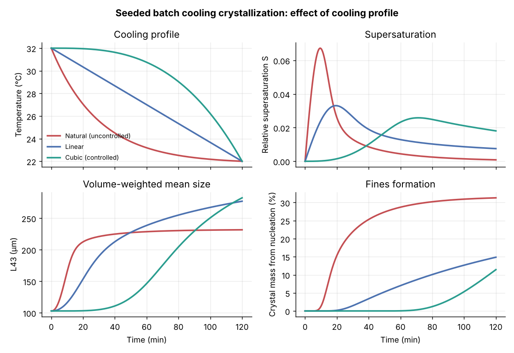
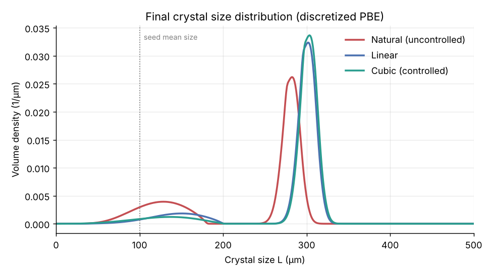
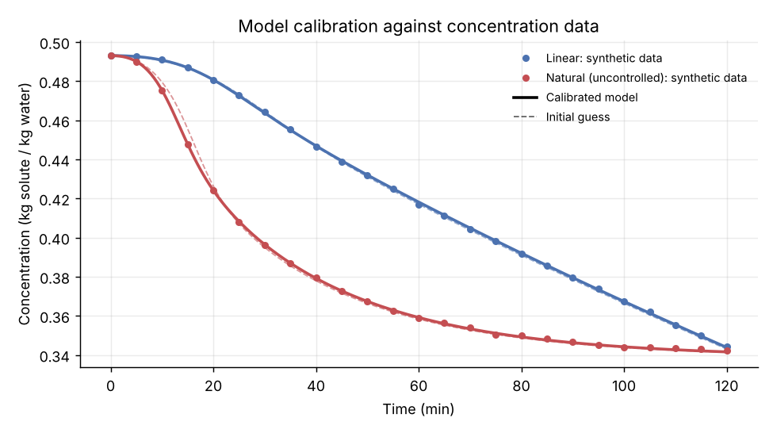

# Batch Cooling Crystallization: Population Balance Model in Python

A mechanistic model of a seeded batch cooling crystallizer. It predicts
supersaturation, crystal growth, nucleation and the final crystal size
distribution (CSD), compares cooling strategies, and calibrates growth
kinetics against concentration data.

The system is a KNO3-like salt crystallizing from water between 32 °C and
22 °C over a 2-hour batch.

## What it does

| Module | Purpose |
|---|---|
| `crystallizer/model.py` | Solubility, supersaturation, growth and nucleation kinetics, cooling profiles, seed distribution |
| `crystallizer/moments.py` | Method-of-moments solution of the population balance (fast, 11 ODEs) |
| `crystallizer/pbe.py` | Discretized population balance (finite volume, van Leer flux limiter) giving the full CSD |
| `crystallizer/estimation.py` | Least-squares calibration of growth kinetics with confidence intervals |
| `run_all.py` | Runs every study and regenerates the figures and tables below |
| `tests/` | 14 verification tests |

## Model

Population balance for size-independent growth with nucleation at zero size:

```
dn/dt + G dn/dL = 0,        n(0, t) = B / G
```

| Quantity | Expression |
|---|---|
| Relative supersaturation | S = (C - C*) / C* |
| Solubility | C*(T) = 0.1286 + 5.88e-3 T + 1.721e-4 T^2  (kg/kg water, T in °C) |
| Growth rate | G = kg S^g |
| Secondary nucleation | B = kb S^b mu3 |
| Solute balance | dC/dt = -3 rho_c kv G mu2 |

The moment equations are `d(mu0)/dt = B` and `d(mu_j)/dt = j G mu_(j-1)`.
Seed-grown and nucleated crystals are tracked as separate populations, so the
share of product mass that comes from nucleation (fines) is reported directly.

## Results

### 1. Cooling profile comparison

Same start and end temperature, same batch time, three cooling strategies.

| Cooling profile | L43 (µm) | Volume CV | Mass from nucleation | Peak S | Yield |
|---|---|---|---|---|---|
| Natural (uncontrolled) | 232 | 0.33 | 31.3% | 0.067 | 99.8% |
| Linear | 277 | 0.21 | 14.9% | 0.033 | 98.3% |
| Cubic (controlled) | 282 | 0.20 | 11.4% | 0.026 | 95.9% |

Natural cooling drives a sharp supersaturation peak early in the batch, when
little crystal surface is available to consume it. That peak triggers a burst
of nucleation, so 31% of the product mass ends up as fines. Controlled (cubic)
cooling keeps supersaturation low until the crystals have grown, cutting fines
to 11% and raising the mean size by 22%. The cost is yield: cubic cooling
finishes with unspent supersaturation and recovers 95.9% of the available
solute, against 99.8% for natural cooling. A hold at the final temperature
would recover it.





### 2. Verification

The method of moments and the discretized PBE are independent numerical
methods. Their final mean sizes (L43) agree within 0.01% for all three
profiles, and the moment model conserves total solute to machine precision.

### 3. Model calibration

Growth parameters `kg` and `g` were estimated from concentration-time data of
two cooling experiments (linear and natural), starting from a deliberately
wrong initial guess.

| Parameter | True | Initial guess | Estimated | 95% interval |
|---|---|---|---|---|
| kg (m/s) | 6.00e-06 | 2.00e-06 | 6.23e-06 | 5.49e-06 to 7.08e-06 |
| g | 1.30 | 1.00 | 1.309 | 1.272 to 1.346 |

The fit residual (4.6e-04 kg/kg) matches the measurement noise that was added
(5.0e-04 kg/kg), so the model explains the data down to the noise level.



## Limitations

- **The calibration data are synthetic.** They were generated from the model
  with known parameters plus Gaussian noise, to show that the workflow
  recovers the truth. No laboratory data were used.
- **Kinetic parameters are illustrative**, chosen to give realistic behaviour.
  They are not fitted to a real KNO3 experiment. The solubility curve is an
  approximate quadratic fit.
- Growth is size-independent; agglomeration, breakage and growth dispersion
  are not modelled.
- The crystallizer is assumed perfectly mixed and its temperature is assumed
  to follow the set profile exactly.

## How to run

```bash
pip install -r requirements.txt
python run_all.py     # regenerates tables and figures
pytest                # runs the 14 verification tests
```

## Possible extensions

- Calibrate against real concentration and CSD measurements.
- Optimize the cooling profile for a size or fines target.
- Add polymorph transformation with two solid phases.
- Wrap the model as a real-time digital twin that updates from live sensor data.
